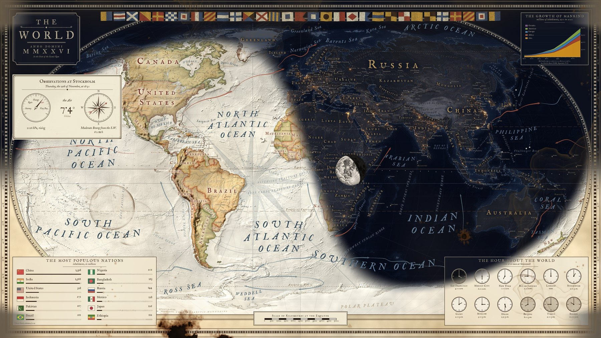
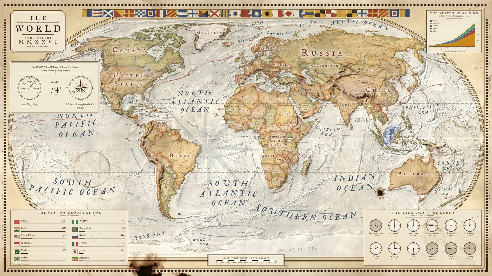
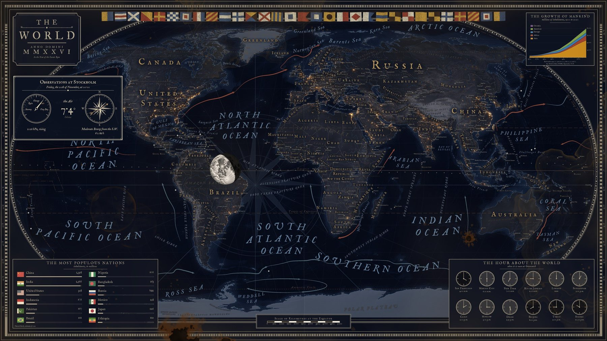
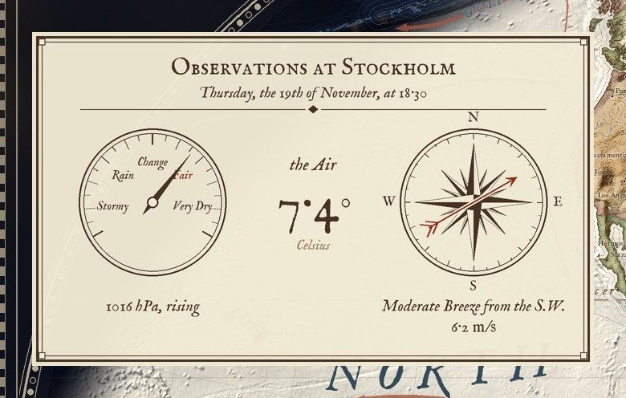

# Atlas add-ons for Home Assistant

[](https://my.home-assistant.io/redirect/supervisor_add_addon_repository/?repository_url=https%3A%2F%2Fgithub.com%2Fmwiorek%2Fha-addons)

## Atlas Frame

**An engraved atlas on your Samsung The Frame, lit by the real sun and moon.**

Atlas Frame turns Art Mode into a living antique atlas. The map on the wall is shaded by the sun of
this very minute: daylight on parchment where it is day, a dark sheet with glowing city lights where
it is night, and a soft terminator sweeping across the world as the hours pass. The moon hangs
where it really is, in its real phase, with its track across the sky. Every few minutes the map
changes to the next one in your rotation.



### What you get
- **Sun and moon, live.** The day and night halves follow the sun; the moon is drawn in its true
  phase and position, with a dotted ground track.
- **A weather cartouche.** An engraved panel in the map's freest corner: a barometer with the old
  words (Stormy, Rain, Change, Fair, Very Dry), the temperature and what it feels like, and a
  compass rose with a fletched arrow flying downwind. It reads your Home Assistant weather entity.
- **Weather at the cities** (optional). Temperature and wind beside each map's biggest cities, from
  Open-Meteo (free, no key; only the cities' public coordinates are sent).
- **Your own sensors at home** (optional). Your temperature, pressure and wind sensors, drawn at
  your home on the map.
- **Calm by design.** It only pushes while the Frame is already in Art Mode, never wakes a TV from
  standby, and only ever deletes the pictures it uploaded itself.
- **Controlled from Home Assistant.** On/off, minutes per map, which maps, light mode and a "next
  map" button are ordinary helpers you can put on a dashboard or in automations.
- **Try it without a TV.** It starts in preview mode and writes each picture to a file you can open.

| Day | Night |
|---|---|
|  |  |



Ships with **The World** and its data forms: population, temperature, temperature now and economic output.

<!-- TODO - map-packs: the regional maps (R1 to R16) are not published. Decide how people get a map
     pack (download, release asset or NAS) and document it here; then restore the Install step about
     regional maps and the README line about them. -->

## Install
1. Click the button above, or in Home Assistant: Settings → Add-ons → Add-on Store → ⋮ →
   Repositories, and add `https://github.com/mwiorek/ha-addons`.
2. Find **Atlas Frame** in the store and install it. It downloads a ready-made image, and updates
   show up like any other add-on's.
3. **Controls (recommended):** copy [`atlas_frame_package.yaml`](atlas_frame/atlas_frame_package.yaml)
   to `config/packages/atlas_frame.yaml`, make sure `configuration.yaml` contains
   ```yaml
   homeassistant:
     packages: !include_dir_named packages
   ```
   and restart Home Assistant. Without it the add-on still runs on defaults: follow the sun,
   2 minutes per map, every installed map.
4. **Start** the add-on. It begins in **preview** mode: no TV needed. Each picture is written to
   `/share/atlas_frame/latest.jpg` (the `share` folder on the Samba share). Open it and watch it change.

## Configure
Settings → Add-ons → Atlas Frame → Configuration.

| Option | What it does | Default |
|---|---|---|
| `preview_only` | `true`: only write `latest.jpg`, never touch a TV. Turn off when the Frame is ready | `true` |
| `tv_host` | The Frame's IP address (give it a fixed one in your router) | empty |
| `weather_entity` | Weather entity for the cartouche (temperature, pressure, wind) | `weather.forecast_home` |
| `legend_place` | The name after "Observations at". Empty uses your Home Assistant location name | empty |
| `weather_show` | What the city weather shows: any of `temperature`, `pressure`, `wind` | temperature, wind |
| `home_sensors` | Your own sensors for the "home readings" layer: `temperature` (°C), `pressure` (hPa), `wind_speed` (m/s), `wind_from` (degrees the wind blows from) | empty |
| `maps_source` | `auto`: side-loaded maps first, then the built-in one. `templates`: built-in only | `auto` |
| `maps_folder` | A folder with maps, e.g. a NAS share at `/share/atlas` | empty |

### Putting it on the wall
1. Give the Frame a fixed IP address and put it in Art Mode.
2. Set `tv_host` to that address and turn `preview_only` off. Restart the add-on.
3. The first time, the TV asks you to allow "Atlas". Allow it; the permission is remembered.
4. Watch the first push: the map should change while the Frame stays in Art Mode.

### Controls in Home Assistant
| Helper | What it does |
|---|---|
| `input_boolean.atlas_frame_on` | Pushing on or off |
| `input_select.atlas_frame_mode` | Follow the sun, Home light, Hold day, Hold dark |
| `input_number.atlas_frame_minutes` | Minutes per map, 1 to 30 |
| `input_text.atlas_frame_maps` | Which maps, in order, e.g. `R1,R7,R15,W1` (maps not installed are skipped) |
| `input_button.atlas_frame_next` | Next map now |
| `input_boolean.atlas_frame_legend` | The weather cartouche (on by default) |
| `input_boolean.atlas_frame_weather` | Weather at each map's cities |
| `input_boolean.atlas_frame_home_readings` | Your own sensors, drawn at home |

`sensor.atlas_frame` shows the map on the wall, when it was pushed, when the next is due, and the
last error or note. A ready-made dashboard card is in the
[documentation](atlas_frame/DOCS.md#controls-home-assistant-helpers).

## Good to know
- Works with Samsung The Frame in Art Mode. Supports `amd64`.
- The connection to the TV is written against the community `samsungframetv` library and has had
  little testing on real TVs yet (the 2026 Frame Pro is not on that library's tested list). If it
  misbehaves, open an issue and say which model you have.
- The full guide, including side-loading maps, is in the add-on's Documentation tab
  ([DOCS.md](atlas_frame/DOCS.md)).

## License
- Code: [MIT](LICENSE).
- The maps and artwork (map pictures, places, grids, moon, icon): [CC BY-NC 4.0](LICENSE-CC-BY-NC-4.0.txt).
  Share them with credit, not commercially.
- Fonts, and the data the maps are drawn from: see [NOTICE.md](NOTICE.md).
