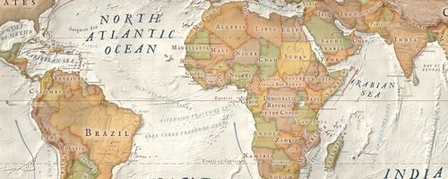
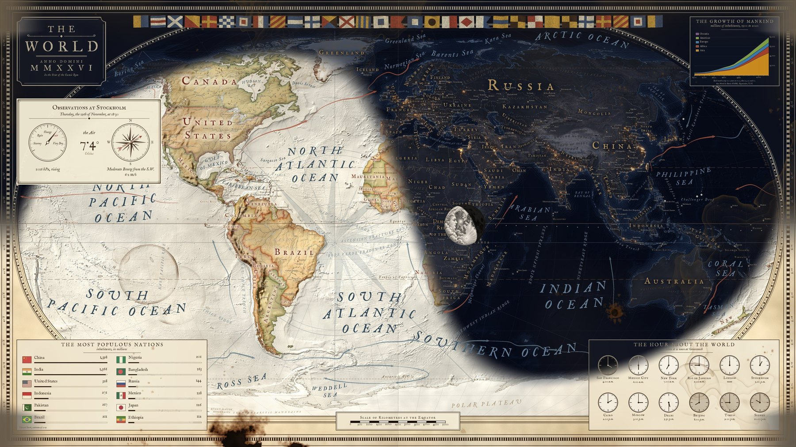

# Atlas Frame

Engraved atlas maps on Samsung The Frame's Art Mode, lit by the live sun and moon. One map at a
time, cut to the next every few minutes, controlled from Home Assistant helpers and reported on
`sensor.atlas_frame`.

- Built in: **The World** (day and night, aged-sheet engraving).
- Side-load the regional maps into the add-on's config folder, or point it at a NAS share.
- Starts in preview mode: no TV needed, each picture lands in `/share/atlas_frame/latest.jpg`.
- Optional weather cartouche (barometer, temperature, wind rose) and city weather from Open-Meteo.

Supports `amd64`. See the Documentation tab for setup, and the [repository page](https://github.com/mwiorek/ha-addons) for more pictures.
